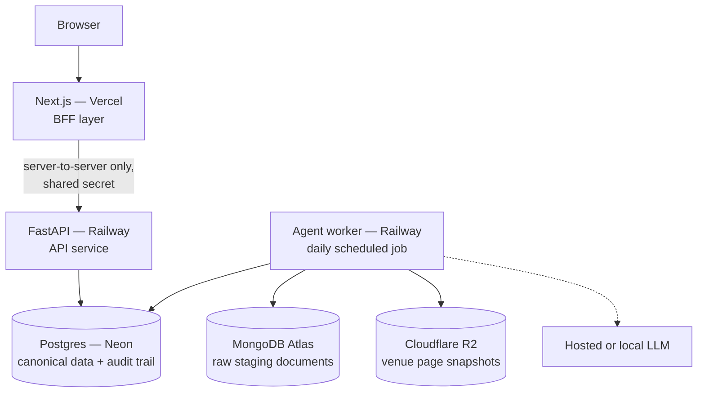
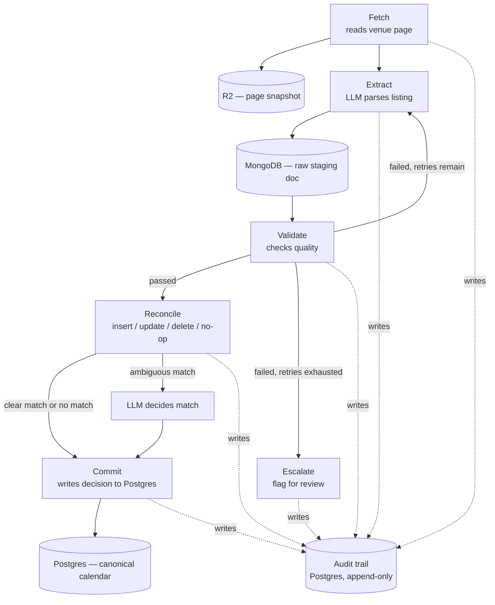

# Agentic Live Music Calendar — Architecture

**Status:** Draft
**Date:** August 4, 2026
**Purpose:** Seed document for implementation. This captures the architecture decisions made before writing code, so the reasoning survives the move into an actual repo.

This document assumes familiarity with `project-overview.md` (problem statement and functional requirements). This file covers *how* it gets built, not *what* it does.

This project began as a small, cost-conscious learning exercise. That origin shaped a few of the early infrastructure choices below; the architecture is otherwise documented on its own merits.

---

## 1. Scope and constraints

- **Cost-conscious infrastructure.** Hosting and data-store choices favor free tiers and low-cost managed services where they don't compromise the design. See [Section 10](#10-cost-summary) for what this actually costs to run.
- **Single region, single metro for now.** Metro is a first-class entity (name, timezone). Venue and Show are scoped to a metro; Artist and the shared vocabulary tables (genre, venue type, instrumentation) are global across metros, since artists tour between markets. The initial build runs one region and one metro. Revisit once there's a second market to serve.
- **Micro-frontend federation is out of scope for v1.** A monorepo structure ([Section 4](#4-frontend-architecture)) gets most of the architectural benefit of a shared design system without the complexity of runtime federation. Revisit only if a second deployable frontend surface makes federation genuinely useful.

---

## 2. System overview

Four services, each doing one job:

| Service | Role | Hosted on |
|---|---|---|
| Next.js | BFF, rendering, the only thing the browser talks to | Vercel |
| FastAPI | API layer, the only thing the browser reaches via the BFF | Railway |
| Agent worker | Scheduled discovery/extraction/validation pipeline | Railway (separate service, same codebase as FastAPI) |
| Postgres | Canonical calendar data, audit trail | Neon |

---

## 3. Hosting and infrastructure

**Decision:** Vercel Hobby (frontend) + Railway Hobby (backend and agents, the agent worker as a cron-scheduled job rather than an always-on process) + Neon free tier (Postgres). No AWS in the primary hosting path.

Vercel doesn't host the FastAPI backend or the agent worker despite technically supporting Python, because its serverless-function model is the wrong shape for both: FastAPI is meant to run as a normal always-on process (a connection pool created once and reused across requests, not spun up fresh per request), and the agent worker is a scheduled batch job — potentially minutes of runtime per invocation, with Playwright's Chromium binary bundled in — not a request handler with a timeout. Railway's long-running containers fit both; Vercel's serverless functions fit neither.

Full picture of what's hosted where and why:

| Service | What it does | Why it exists here |
|---|---|---|
| **Vercel** | Hosts `apps/web` (Next.js) | Its native fit — request/response, preview deploys per PR |
| **Railway** | Hosts two separate services: the always-on FastAPI backend, and the agent worker as a cron-scheduled job | Long-running containers, not serverless functions — see above |
| **Neon** | Postgres — the canonical, validated calendar data and the audit trail | Structured, relational, needs reliable querying ([Section 6](#6-data-architecture)) |
| **MongoDB Atlas** | Raw agent-extraction output, pre-validation | Schema-flexible staging for variable-shaped extraction data ([Section 6](#6-data-architecture)) |
| **DeepInfra** | Hosted LLM inference in production | The production stand-in for local Ollama — same `openai`-compatible client, just a different `base_url` ([Section 7](#7-agent-workflow-and-auditability)) |
| **Cloudflare R2** | Object storage for raw page snapshots | Every Fetch saves what it retrieved, part of the audit trail ([Section 7](#7-agent-workflow-and-auditability)) |
| **Cloudflare Turnstile** | Bot-check gating the public edit/flag endpoints | Anyone can edit or flag a listing with no account required ([Section 7](#7-agent-workflow-and-auditability)) |
| **Resend** | Transactional email — contributor verification links, magic-link login | Part of the optional-identity contributor flow ([Section 7](#7-agent-workflow-and-auditability)) |

Per the Cost Summary ([Section 10](#10-cost-summary)), this entire stack is roughly $5/month — Railway is the only line item that isn't free-tier.

**Multi-region / multi-metro:** designed for (see [Section 1](#1-scope-and-constraints) for the metro-scoped vs. global entity split) but not built. Single region, single metro for now. Revisit once there's a second market to actually serve.

---

## 4. Frontend architecture

- **Framework:** Next.js, App Router.
- **Rendering strategy:** React Server Components by default, `'use client'` only where interactivity is required, Partial Prerendering for pages that mix static and dynamic content (calendar listings are mostly static; filters and chat search are the interactive portions within them).
- **Note on terminology:** "islands architecture" is an Astro-specific pattern and doesn't apply directly to a Next.js app. The functionally equivalent approach inside Next.js is RSC + Partial Prerendering — same outcome (minimal JS shipped for content-heavy pages), achieved through a different mechanism.
- **Monorepo:** Turborepo, `apps/web` (Next.js) plus `packages/ui` (shared component library) plus `packages/config`. Turborepo governs the JS/TS task graph only — it doesn't manage the Python backend, which lives in the same repo but outside Turborepo's pipeline, with its own lint/test tooling.
- **Design system:** built as `packages/ui` from the start. Directly required by the component-library requirement in the project spec, and the natural home for shared tokens if per-metro-area branding becomes real.
- **Component library:** shadcn — Tailwind CSS for styling, Radix UI primitives underneath, component source copied into `packages/ui` rather than installed as an opaque dependency.
- **Calendar UI:** fully custom, not a calendar-grid library — the actual layout (a vertically scrolling list of dates, each with a horizontally scrolling row of venue columns) isn't a variant of a month/week/day grid, it's a different UI pattern entirely, closer to a feed than to what react-big-calendar or similar libraries are built for.
- **Dates:** the Temporal API (native, with the official polyfill as a fallback for browsers without it yet) rather than a legacy date library — current browser support (Chrome 144+, Firefox 139+ native) makes it the more defensible choice for a project starting now.
- **Content model:** every event, venue, and artist has its own server-rendered detail page, not just a calendar-grid entry — indexable, shareable, deep-linkable, and it resolves the tension between the calendar's client-side interactivity and the SEO requirement in the project spec. Detail pages carry `schema.org` Event JSON-LD. Venues and artists also get directory/listing pages, same reasoning extended to browsing by name rather than only by date.
- **Filter and view state:** URL search params, not component state — filters, the current view, and the displayed date range are all shareable and bookmarkable, and let the server render the right result directly from the URL.
- **Location:** venue addresses link out to Google Maps via a constructed search URL (`https://www.google.com/maps/search/?api=1&query=` plus the encoded address) — no geocoding API, no embed dependency, no billing.

**Libraries.**

| Concern | Library |
|---|---|
| Forms | `react-hook-form` with `zod` schemas, mirroring the backend's Pydantic shapes |
| Data fetching (mutations) | TanStack Query, scoped to edit/flag/retrigger actions; the main calendar browse stays server-rendered |
| Server-to-server calls | Native `fetch` |
| Component testing | `vitest`, `@testing-library/react` |
| End-to-end testing | Playwright — already a dependency for the agent pipeline's headless fetch |
| Icons | `lucide-react`, matching shadcn's own examples |

**Deferred:** true micro-frontend federation. See [Section 1](#1-scope-and-constraints). Client-side state management (e.g. Zustand) is also not yet decided — no concrete use case has earned it so far; revisit once the detailed requirements surface one.

---

## 5. Backend architecture

- **Framework:** FastAPI (Python), one service on Railway.
- **BFF pattern:** Next.js server components and route handlers are the only callers of the FastAPI service. The browser never sees FastAPI's URL or credentials, and there's no client-side CORS surface to secure.
- **Service-to-service auth:** a shared secret, stored as a server-only environment variable on both Vercel and Railway (never exposed to the client bundle), checked as a header on every request.
- **Data access:** FastAPI and the agent worker ([Section 7](#7-agent-workflow-and-auditability)) both connect directly to Postgres, sharing one Python package of SQLAlchemy models and one Alembic migration history rather than routing writes through FastAPI's HTTP API. Shared business logic (reconcile decisions, audit-trail writes, validation) lives in functions both call. Schema changes follow an expand-contract pattern, since the two services don't redeploy at the same instant.

**Libraries.**

| Concern | Library |
|---|---|
| ASGI server | Uvicorn (dev and prod), optionally under Gunicorn as a process manager |
| Postgres driver | `asyncpg` |
| Typed settings | `pydantic-settings` |
| Testing | `pytest`, `pytest-asyncio`, FastAPI's `TestClient` |
| Test data | `polyfactory` |
| Linting, formatting, type checking | `ruff`, `mypy` or `pyright` |
| Structured logging | `structlog` |
| MCP admin server | FastMCP, generated from the existing FastAPI routes |
| Rate limiting | `slowapi` |
| On-demand pipeline triggering | FastAPI's built-in `BackgroundTasks` |
| Anonymous session identity | Starlette's `SessionMiddleware` |
| Sending verification/login emails | Resend |
| Bot mitigation on public edit/flag endpoints | Cloudflare Turnstile |

---

## 6. Data architecture

Different shapes of data get different stores, rather than forcing everything into one database.

| Store | What lives there | Why this store |
|---|---|---|
| **Postgres (Neon)** | Canonical, validated calendar data (venues, acts, listings); the audit trail | Structured, relational, needs to be queried and filtered reliably by the app |
| **MongoDB Atlas (M0, free)** | Raw agent-extraction output, pre-validation | Venue calendar formats aren't standardized — some list ticket price, some don't, some have ambiguous multi-act ordering. Schema-flexible storage fits variable-shaped data better than a fixed relational schema |
| **Cloudflare R2 (free tier)** | Raw HTML/text snapshot of each venue page at fetch time | A blob, not a document or a row — belongs in object storage, referenced by key from the audit trail |
| **Upstash Vector (free tier, added later)** | Embeddings for chat-based semantic search | Deferred until the chat-search feature is built — no need to provision this before there's a consumer for it |

**On the MongoDB decision specifically:** raw extraction output varies in shape by venue and hasn't been validated yet, which is the standard case for a document store over a fixed relational schema. Once validated, the reconcile step normalizes the record into Postgres. Raw/staging in MongoDB, canonical/validated in Postgres — the same shape as a bronze/silver data-layering pattern, implemented as two services instead of one data lake.

**Rejected:** a NoSQL store for the venue-page snapshots themselves. Large raw blobs are a worse fit for a document database than for object storage.

**Client libraries:** `pymongo`'s native async API (`AsyncMongoClient`) for MongoDB, not `motor` — MongoDB deprecated Motor in May 2025 and moved async support natively into PyMongo (4.9+). `boto3` for R2, which is S3-compatible.

**Metadata schema.** Venue and artist attributes split three ways. Single-valued, stable dimensions (all-ages, venue type, indoor/outdoor) are typed columns, for reliable indexed filtering. Multi-valued dimensions (genre, instrumentation) are many-to-many join tables against a shared vocabulary that contributors can extend, not a free-text field on the record — an uncontrolled text field fragments ("folk" / "Folk" / "folk music") in a way a shared list doesn't, even one open to new entries. Newer or more speculative metadata lives in a JSONB `extra_metadata` column, filterable via Postgres's JSONB operators and a GIN index, with no migration required to add a field; a field graduates to a real column once it proves out and needs to be a reliably filtered dimension.

---

## 7. Agent workflow and auditability

The agent workflow is designed to be auditable by construction, not as an afterthought.

**Fetch and extract.** The venue list is read from Postgres on every run; every venue is refetched each time, with no per-venue scheduling logic. Fetch traverses as far into the future as a venue's page allows, following "load more" or "next" pagination rather than capturing a single page — which broadens when Playwright is needed beyond the JS-rendering case: a plain HTTP fetch can follow URL-based pagination, but a click-driven "load more" needs a headless browser regardless of whether the page itself is otherwise static. Fetch strategy remains configurable per venue, tracked as a field on the venue record. Each page traversed gets its own R2 snapshot, and the run records how far it actually reached — that captured boundary, not a fixed number of days, is what scopes the delete-diff in Reconcile below, since pagination depth varies run to run. Extraction produces a structured record against a fixed schema (venue, date, time, act name(s), a flag for ambiguous ordering/timing, ticket info if present, confidence), using the model provider's structured-output mode rather than free-text parsing.

**Validation and retry.** Validation checks completeness, plausibility, and internal consistency of the extracted record. Two distinct failure modes are handled differently:
- A **fetch failure** (network error, empty response) retries Fetch directly, with backoff.
- A **low-confidence or inconsistent extraction**, with the fetch itself having succeeded, retries Extract only, against the already-saved snapshot rather than a fresh network fetch, and escalates in approach on each attempt (adjusted prompt, then a larger model) rather than repeating the identical call.

Retries are capped (3 attempts). Exhausting the cap escalates to human review rather than looping indefinitely.

**Reconcile (insert / update / delete / no-op).** Mostly deterministic; the LLM is reserved for the one genuinely ambiguous case. Two different entities go through this pattern with different concrete rules. **Shows** match on venue, date, and time, an exact key with no fuzzy matching involved, so a time change (an 8 p.m. show disappearing while a 9 p.m. one appears) reads as the old show cancelled and a new one created, while a lineup change at the same date and time updates the existing record. **Artists** match on name, which isn't exact by nature, so the ambiguous-match row below applies to artist matching specifically, not to shows. Reconcile decides the outcome; a separate `commit_node` writes that decision to Postgres — kept apart because "decide what should happen" and "make it happen" are different failure modes worth attributing separately in the audit trail (a bad reconcile decision is a logic bug; a failed commit is a database/connectivity problem). The ambiguous-artist-match case (`LLMMatch` in the diagram above) is a conditional branch inside `reconcile_node`, not its own node — it's still reconcile deciding, just with an LLM call involved in reaching that decision.

| Outcome | How it's decided | Agentic or programmatic |
|---|---|---|
| No-op (unchanged) | Field/hash comparison against the existing record | Programmatic |
| Delete (soft) | Set-diff: anything in the stored calendar but missing from the latest fetch, within the date range that fetch actually covered, is marked inactive, never hard-deleted | Programmatic |
| Insert (new show) | Composite key (venue, date, time) finds no match | Programmatic |
| Update (changed details) | Composite key (venue, date, time) finds a clear match; a differing lineup at the same key updates the existing show | Programmatic |
| Ambiguous match (artist names only) | Fuzzy name-similarity score lands in the middle, neither a clean match nor a clean miss | Agentic — an LLM decides, and that decision is itself audited |

Deterministic logic is also more explainable by construction: a match based on venue, date, and time is a stronger answer to "why did this update happen" than a model's judgment call, which is why the ambiguous case stays scoped narrowly to artist-name matching rather than the general rule.

**Audit trail extensions.** A `reconcile` step_type sits between `validate` and `commit`, logging whether the CRUD decision was made deterministically or by the LLM fallback (and, if agentic, the same `model_used`/`confidence` fields as extract and validate). A `parent_run_id` groups every attempt, including retries, for one venue-processing cycle; each attempt gets its own row via `attempt_number`, so retry history is preserved rather than overwritten, consistent with the append-only design. A `source` column (`agent` or `user`) lets the same table record human edits and flags alongside agent runs, with person-specific fields (self-reported identifier and its verification status, hashed session/IP, previous/new value for revert) alongside the agent-specific ones.

**New venue submissions.** Any user can submit a venue and its calendar URL. The submission runs through the same fetch → extract → validate stages as a scheduled run, scoped to just that one URL; a credible result (shows that pass validation) is accepted automatically, and a submission that produces nothing credible is marked invalid, both outcomes recorded in the audit trail. No human review gate by default — the existing validation and confidence-scoring pipeline is the gate.

**Public edit and re-trigger model.** Direct edits to venue, act, and show records are open to anyone, no account required — Event exists as a data entity in v1 but isn't necessarily a v1 UI surface, so it's left out of this list for now. Edits are cheap and instantly revertable, so audit-trail visibility does the work access control would otherwise do. Re-running the pipeline is a different risk tier (real inference cost, a real request to the venue's own site) and is rate-limited per record rather than per user, since per-user limits don't stop distributed anonymous abuse. Flagging a listing as wrong is free and open; the actual re-run fires once a listing crosses a small flag threshold or its cooldown allows it, with a global daily cap on total runs underneath both paths. Cloudflare Turnstile gates edits and flags against bots. Any self-reported identifier a contributor provides is attribution only, not part of the abuse-prevention logic.

**Revert.** A first-class action, not something reconstructed by hand from the audit log — restoring a prior version needs to be as easy as making the edit.

**Identity for contributors.** An email is optional at edit time. The first time an address is used, a verification link is sent; the edit itself applies immediately regardless of whether or when that link is clicked. Verification is what unlocks a contribution-history page and a later magic-link login — until then, the address is a pending, unconfirmed attribution visible only in the audit trail, not a public identity anyone could claim under an email they don't own. Login re-establishes the same anonymous session already in use, upgraded to a confirmed state tied to the verified email, rather than a separate account system. Resend sends the verification and login links; that send action is rate-limited separately from the edit and flag limits above.

**Manual triggering.** An MCP server, layered thin over the existing FastAPI endpoints and the same service-to-service auth, exposes: triggering the full job on demand, listing runs below a confidence threshold, re-triggering a specific prior run, and retrieving the full audit trail for a run. This provides an operational interface without requiring a dedicated admin frontend first.

**Orchestration framework.** The pipeline (fetch → extract → validate → reconcile → commit, with a bounded retry loop) has a known shape rather than being an open-ended agent deciding at runtime what to do next, which makes it a reasonable fit for a graph-based orchestration framework rather than requiring one. Decision: LangGraph. Pipeline stages map to nodes (plain functions operating on a shared state object); the passed / failed-with-retries-remaining / failed-with-retries-exhausted branch in the validation step maps to conditional edges reading that state. LangGraph's checkpointing and persistence layer is deliberately not used, since that layer exists for long-running agents that need to survive a process restart mid-task, and this job completes within a single process invocation once a day. The graph runs in-memory per venue, with no checkpointer configured. Given LangGraph's history of breaking changes between versions, the version in use is pinned deliberately and upgraded on purpose rather than tracked at latest.

**Libraries.**

| Concern | Library |
|---|---|
| Fetching pages | `httpx` |
| Parsing plain HTML | `BeautifulSoup` or `selectolax` |
| Fetching JS-rendered pages | `Playwright` |
| Calling the model | `openai` SDK — OpenAI-compatible across Ollama, DeepInfra, Groq, and similar providers, so one client library covers local and hosted inference |
| Defining the extraction schema | `pydantic` |
| Enforcing schema-valid model output | `instructor` — retries a malformed model response until it matches the Pydantic schema; a distinct concern from the pipeline-level retry above, which responds to well-formed but low-confidence output |
| Transient network retries | `tenacity` |
| Scheduling the daily run | Railway's native cron scheduler — no separate scheduling library needed |

**Model selection.** Extraction and validation are jobs for a small-to-mid open-weight model rather than a frontier one; schema-constrained structured output and clear prompting affect reliability more than raw model size for this kind of task. Local development runs against Ollama, sized to available hardware. Production runs against a hosted inference provider serving the same model family, chosen for catalog breadth and per-token cost among current options; this document intentionally doesn't pin a specific model version, since that segment of the ecosystem changes quickly. Extraction and validation can share one model initially; reserving a larger model for validation only is a reasonable adjustment if validation proves too lenient.

**A structured-output reliability risk, confirmed during local model evaluation (see `docs/dev/env-setup.md` Phase 5) and worth designing around regardless of which specific model is in use:** "thinking"-capable models — increasingly the default even at small open-weight sizes — can fail to complete `instructor`'s structured-output flow well within a generous token budget, spending it all on internal reasoning instead. This doesn't correlate with how much content is on the page; it correlates with how much interpretive judgment the content demands in one pass. A long but uniform, unambiguous listing (the same recurring show format repeated many times) extracts reliably; a short listing with one judgment call embedded in it (a non-music event mixed into an otherwise musical calendar, an ambiguous date format) can exhaust the budget and fail outright. This is concrete grounding for the "adjusted prompt" escalation step above, not a reason to introduce new machinery: on a retry, narrowing the model's task — fewer entries per call, or an explicit instruction addressing the specific ambiguity — is a better first move than simply allowing a larger completion or escalating straight to a bigger model.

---

## 8. Local development

The primary dev loop, not an afterthought. Full stack runs offline, at zero cost.

- **Next.js:** `next dev`.
- **FastAPI:** `uvicorn app.main:app --reload`.
- **Postgres:** `docker-compose.yml` at the repo root spins up a local container. Same schema as Neon, kept in sync through Alembic migrations.
- **Agents:** run as local Python scripts. Model target is an environment-variable toggle — Ollama locally for fast iteration, a hosted endpoint when production fidelity matters.

Cloud environments (preview and production) exist for integration testing and demos, not day-to-day iteration.

---

## 9. Deployment and environments

**Repo structure:** one monorepo. Turborepo governs `apps/web` and shared JS/TS packages. The FastAPI app sits alongside it with its own tooling (ruff, pytest); Railway is pointed at that subdirectory as its own deployable service.

**CI:** GitHub Actions runs lint, type-check, and tests on every PR, required to pass before merge to `main`. Vercel and Railway both deploy on push, no custom pipeline needed for the deploy mechanics themselves.

**Non-prod vs. production, by layer:**

| Layer | Non-prod | Production |
|---|---|---|
| Vercel | Automatic preview deployment per branch/PR | Deploys from `main` |
| Railway | Not configured yet — see Sequencing below | `production` environment |
| Neon | Native Vercel integration auto-creates a database branch per preview deployment, copy-on-write, deleted when the branch closes | The project's default branch |

**Cost note:** a PR-triggered Railway environment that tears itself down costs almost nothing. A permanent, always-on staging environment roughly doubles the Railway bill. Favor ephemeral PR environments over a persistent staging environment.

**Sequencing:**
- **Phase 1:** local dev plus a single production deploy. Ship something real end-to-end first.
- **Phase 2:** once the app has enough surface area that a broken preview would actually catch something, layer in the full preview-per-PR pattern across all three services.

---

## 10. Cost summary

| Item | Monthly cost |
|---|---|
| Vercel Hobby | $0 |
| Railway Hobby | $5 |
| Neon (Postgres, free tier) | $0 |
| MongoDB Atlas M0 | $0 |
| Cloudflare R2 (free tier, up to 10GB) | $0 |
| Upstash Vector (free tier, when added) | $0 (up to 10K vectors) |
| **Total** | **~$5/month** |

**Explicitly out of scope for now (cost-driven):** AWS EKS as ongoing infrastructure, a dedicated log aggregation service (Vercel/Railway's built-in dashboards cover v1), a persistent Railway staging environment.

---

## 11. Deferred decisions

Tracked here so they don't get silently forgotten:

- **Multi-region deployment** — designed for, not built. Revisit when there's a second metro area to serve.
- **Multi-metro scoping enforcement** — the metro-scoped vs. global entity split exists in the design ([Section 1](#1-scope-and-constraints)) but isn't enforced in code yet.
- **Metro-aware fetch scheduling** — the daily fetch runs at a fixed local time (4 a.m.) per Metro's timezone; a single Railway cron trigger covers this correctly with one metro live, but needs to become metro-aware (multiple triggers, or one that checks which metro's local 4 a.m. it currently is) once a second metro in a different timezone exists.
- **True micro-frontend federation** — only if a second deployable frontend surface makes it worth the complexity.
- **Vector search / chat search** — feature isn't built yet, so Upstash Vector isn't provisioned yet either.
- **Cloudflare Turnstile / Resend** — both gate features that don't exist yet (public edit/flag endpoints, contributor verification/login), so neither is provisioned yet. Not needed until the app actually accommodates an anonymous public user.
- **Cloudflare R2** — the agent worker's Fetch step is designed to write a snapshot per page (see [Section 7](#7-agent-workflow-and-auditability)), but that write is explicitly stubbed out in `fetch_node` for now (as is the MongoDB raw-staging write in `extract_node`) until the graph's core shape is proven end to end. Not provisioned yet.
- **Dedicated log aggregation** (e.g., Axiom) — platform-native dashboards are enough until they aren't.
- **Per-record protection tiers** — a record repeatedly vandalized could require identification or admin-only editing; not built, but worth reserving a field for now.
- **Contributor trust tier** — verified contributors with an established track record could unlock small capabilities, such as their flags counting more toward the re-trigger threshold; not built, but a natural extension once verification exists.
- **Custom domain** — deferred; Vercel/Railway default subdomains for now, not a scaffolding blocker.
