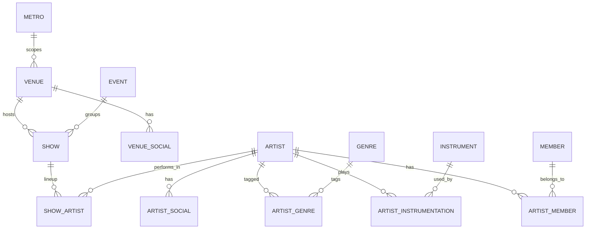
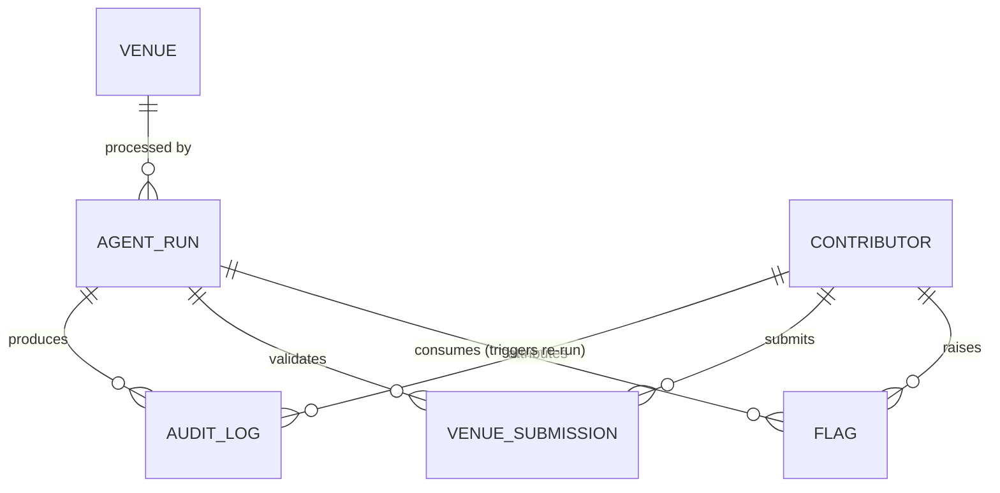

# Agentic Live Music Calendar — Data Model

**Status:** Draft
**Date:** August 14, 2026
**Purpose:** Canonical Postgres schema for the application, derived from `requirements-initial.md` (screen-by-screen functional requirements), `arch-initial.md` Section 6 (data architecture) and Section 7 (agent workflow and auditability), and `project-overview.md` (problem statement). This document assumes familiarity with all three.

This covers the **Postgres schema only** — the canonical, validated store. Raw agent-extraction output before validation lives in MongoDB as schema-flexible documents (see `arch-initial.md` Section 6); that shape is deliberately not fixed here, since the entire point of staging it in Mongo is that it varies by venue and hasn't been normalized yet. Page snapshots live in R2 as blobs, referenced by key.

---

## 1. Conventions

- **Primary keys:** `id`, `Integer`, autoincrementing — consistent with the first migration (`db2aedec0bb9_create_metro_and_venue_tables.py`), which already establishes this for `metro` and `venue`.
- **Table names:** singular, `snake_case` (`venue`, not `venues`).
- **Timestamps:** `created_at` / `updated_at`, `timestamptz`, defaulting to `now()`, on every table below unless noted otherwise.
- **Enums:** implemented as native Postgres `ENUM` types, not free-text columns, for the fields `arch-initial.md` Section 6 calls out as "single-valued, stable dimensions" (age restriction, venue type, setting, seating, etc.) — typed for reliable indexed filtering.
- **Shared vocabulary, multi-valued:** genre and instrument are "multi-valued dimensions... many-to-many join tables against a shared vocabulary that contributors can extend" per the same section. Each gets its own lookup table plus a join table.
- **`extra_metadata` JSONB:** present on `venue` and `artist` per the metadata schema in Section 6 — speculative or newly-requested fields land here first, filterable via a GIN index, and graduate to a real typed column once they prove out.
- **Soft delete:** used only where the product spec calls for it explicitly. That's `show.status`, per the reconciliation rule in `requirements-initial.md` ("marked removed, not deleted outright — the record and its history are kept"). Venue and Artist edits don't need a status column — they're "cheap and instantly revertable" through the audit trail's previous/new value pairs instead (`arch-initial.md` Section 7).
- **Metro scoping:** `venue` and `show` (transitively, via venue) carry `metro_id`. `artist` and the vocabulary tables (`genre`, `instrument`) are global, since artists and shared vocabulary aren't metro-specific (`arch-initial.md` Section 1). Enforcement of this split in application code is tracked as a deferred item in `arch-initial.md` Section 11, not built yet.

---

## 2. Core calendar domain

### `metro`

Already established by the first migration. Listed here for completeness.

| Column | Type | Nullable | Notes |
|---|---|---|---|
| `id` | Integer | PK | |
| `name` | String | No | |
| `timezone` | String | No | IANA name, e.g. `America/Chicago`. Drives the per-metro 4 a.m. agent trigger (`arch-initial.md` Section 11). It is also the zone every `show.date` / `start_time` / `end_time` (and `show_artist.start_time`) in the metro is read in: those columns are naive, local wall-clock values, and an extraction source that gives an offset or UTC (schema.org JSON-LD does) is converted into this zone before it is stored (`requirements-initial.md`, Metro). |

### `venue`

Required fields per `requirements-initial.md` are marked `*`: **Venue name**, **Live Music Calendar URL**.

| Column | Type | Nullable | Notes |
|---|---|---|---|
| `id` | Integer | PK | |
| `metro_id` | Integer, FK → `metro.id` | No | |
| `name` | String | No | * |
| `calendar_url` | String | No | * "Live Music Calendar URL" |
| `photo_url` | String | Yes | Link to a photo hosted elsewhere. |
| `address` | Text | Yes | Rendered as a constructed Google Maps search link, no geocoding (`arch-initial.md` Section 4). |
| `phone_numbers` | `text[]` | Yes | Venue can list more than one; a plain array rather than a child table since entries carry no per-entry metadata. |
| `emails` | `text[]` | Yes | Same reasoning as `phone_numbers`. |
| `website` | String | Yes | |
| `age_restriction` | Enum `age_restriction` (`all_ages`, `twenty_one_plus`) | Yes | Venue-level default; a `show` can override. |
| `serves_alcohol` | Boolean | Yes | Venue-level default; a `show` can override. |
| `venue_type` | Enum `venue_type` (`bar`, `club`, `theater`, `coffeehouse`, `arena`, `park`, `other`) | Yes | Single-valued, stable dimension → typed column, not a vocab table (`arch-initial.md` Section 6). |
| `setting` | Enum `setting` (`indoor`, `outdoor`, `both`) | Yes | Venue-level default; a `show` can override. |
| `seating` | Enum `seating` (`standing`, `seated`, `both`) | Yes | Venue-level default; a `show` can override. |
| `fetch_strategy` | Enum `fetch_strategy` (`http`, `browser`) | No, default `http` | "Fetch strategy remains configurable per venue" (`arch-initial.md` Section 7) — set to `browser` when a venue's calendar needs Playwright (click-driven "load more"). |
| `extra_metadata` | JSONB | Yes | GIN-indexed; speculative fields land here before graduating to a column. |

### `venue_social`

"A venue can associate many social accounts... a 'type' of Social, which specifies whether it's Instagram, YouTube, TikTok, etc." One row per account.

| Column | Type | Nullable | Notes |
|---|---|---|---|
| `id` | Integer | PK | |
| `venue_id` | Integer, FK → `venue.id` | No | |
| `platform` | Enum `social_platform` (`instagram`, `youtube`, `tiktok`, `facebook`, `x`, `spotify`, `bandcamp`, `soundcloud`, `other`) | No | |
| `url` | String | No | |
| `label` | String | Yes | Free-text platform name when `platform = 'other'`. |

### `artist`

Required field: **Artist name**.

| Column | Type | Nullable | Notes |
|---|---|---|---|
| `id` | Integer | PK | Global, not metro-scoped — artists tour between markets. |
| `name` | String | No | * |
| `photo_url` | String | Yes | |
| `website` | String | Yes | |
| `hometown` | Text | Yes | Free text, not an FK to `metro` — "not a reference to a particular metro, even though the concept is similar." |
| `format` | Enum `artist_format` (`solo`, `duo`, `trio`, `band`) | Yes | Describes the act itself, not a given performance's configuration (a solo artist with a backing band is still `solo`). |
| `repertoire` | Enum `artist_repertoire` (`original`, `cover`, `both_other`) | Yes | Fixed enum, explicitly not a tag set per the spec. |
| `extra_metadata` | JSONB | Yes | GIN-indexed, same pattern as `venue.extra_metadata`. |

Note: an agent-created stub state for artists (name-only records awaiting enrichment) is called out in `requirements-initial.md` as a *possible* v2 feature, not a v1 requirement — no column added for it yet. See [Section 5](#5-open-questions--deferred).

### `artist_social`

Same shape as `venue_social`, scoped to artist instead.

| Column | Type | Nullable | Notes |
|---|---|---|---|
| `id` | Integer | PK | |
| `artist_id` | Integer, FK → `artist.id` | No | |
| `platform` | Enum `social_platform` | No | Shared enum with `venue_social`. |
| `url` | String | No | |
| `label` | String | Yes | |

### `genre` / `artist_genre`

"Genre should be a tagging system, an artist can be tagged for multiple genres" — a shared, contributor-extendable vocabulary, per Section 6's multi-valued-dimension rule.

**`genre`**

| Column | Type | Nullable | Notes |
|---|---|---|---|
| `id` | Integer | PK | |
| `name` | String, unique | No | |

**`artist_genre`** (join table, composite PK)

| Column | Type | Nullable | Notes |
|---|---|---|---|
| `artist_id` | Integer, FK → `artist.id` | No | |
| `genre_id` | Integer, FK → `genre.id` | No | |

### `instrument` / `artist_instrumentation`

"A multiselect list of instruments and their count (like guitar x2)... a table that feeds this list but users can add an instrument."

**`instrument`**

| Column | Type | Nullable | Notes |
|---|---|---|---|
| `id` | Integer | PK | |
| `name` | String, unique | No | |

**`artist_instrumentation`** (join table)

| Column | Type | Nullable | Notes |
|---|---|---|---|
| `id` | Integer | PK | Own surrogate key rather than a composite one, since `(artist_id, instrument_id)` alone can't carry the count if the UI ever allows multiple entries of the same instrument at different counts; a single row per instrument per artist is the expected case. |
| `artist_id` | Integer, FK → `artist.id` | No | |
| `instrument_id` | Integer, FK → `instrument.id` | No | |
| `count` | Integer | No, default `1` | "guitar x2" |

### `member` / `artist_member`

"Members should be a table of its own so that a person can be a member of multiple artists."

**`member`**

| Column | Type | Nullable | Notes |
|---|---|---|---|
| `id` | Integer | PK | |
| `name` | String | No | |

**`artist_member`** (join table, composite PK)

| Column | Type | Nullable | Notes |
|---|---|---|---|
| `artist_id` | Integer, FK → `artist.id` | No | |
| `member_id` | Integer, FK → `member.id` | No | |

### `event`

"Event is a parent of Shows... should be used when it's a music festival or other situations where there are multiple shows." Not a v1 UI surface (`arch-initial.md` Section 7), but exists as a data entity per `requirements-initial.md`.

| Column | Type | Nullable | Notes |
|---|---|---|---|
| `id` | Integer | PK | |
| `name` | String | No | |
| `start_date` | Date | Yes | Derived: `min(show.date)` across associated shows. Recomputed when a member show's date changes, not independently editable. |
| `end_date` | Date | Yes | Derived: `max(show.date)`, same recomputation rule. |

The "must have more than one Show to be an Event" rule is an application-layer invariant, not a DB constraint — a `CHECK` can't easily express "at least two rows in a child table."

### `show`

Required field: **Date**. Several fields are described as "inherited by default from venue but can be overwritten... they remain empty unless there is an input that is different from the parent venue" — those are nullable columns that mean "use the venue's value" when null, and an explicit value when set.

| Column | Type | Nullable | Notes |
|---|---|---|---|
| `id` | Integer | PK | |
| `venue_id` | Integer, FK → `venue.id` | No | |
| `event_id` | Integer, FK → `event.id` | Yes | Null for a standalone show. |
| `date` | Date | No | * |
| `start_time` | Time | Yes | |
| `end_time` | Time | Yes | Left blank if unclear. |
| `age_restriction` | Enum `age_restriction` | Yes | Null = inherit from `venue.age_restriction`. |
| `serves_alcohol` | Boolean | Yes | Null = inherit from `venue.serves_alcohol`. |
| `setting` | Enum `setting` | Yes | Null = inherit from `venue.setting`. |
| `seating` | Enum `seating` | Yes | Null = inherit from `venue.seating`. |
| `admission_advance` | Numeric | Yes | Advance-purchase price. |
| `admission_day` | Numeric | Yes | Day-of price. |
| `free_admission` | Boolean | Yes | `CHECK (NOT (free_admission AND (admission_advance IS NOT NULL OR admission_day IS NOT NULL)))` — mirrors the internal-consistency rule agents validate against in `requirements-initial.md`. Absence of a price does *not* imply `true`. |
| `image_url` | String | Yes | Poster link. |
| `original_url` | Text | Yes | The venue page this show was most recently extracted from; overwritten on each successful reconcile, not a history — history lives in `audit_log`. |
| `status` | Enum `show_status` (`active`, `removed`) | No, default `active` | Soft delete per the reconciliation rule: a show missing from a subsequent fetch, within the date range that fetch covered, is marked `removed`, never hard-deleted. |

### `show_artist`

"Artists: artist performing. One or more. Each artist can have its own time... each artist can also have sequence number."

| Column | Type | Nullable | Notes |
|---|---|---|---|
| `show_id` | Integer, FK → `show.id` | No | Composite PK with `artist_id`. |
| `artist_id` | Integer, FK → `artist.id` | No | |
| `start_time` | Time | Yes | This artist's own set time, distinct from `show.start_time`. |
| `sequence_number` | Integer | Yes | Performance order; if the source listing doesn't specify one, the agent assumes an order from listing order (see `requirements-initial.md`, Agent Extraction: Fields). |

---

## 3. Agent workflow & audit domain

Covers `arch-initial.md` Section 7 end to end: runs, the append-only audit trail, new-venue submissions, flags, and contributor identity for anonymous/verified edits.

### `agent_run`

Represents one venue-processing cycle — the unit that `arch-initial.md` calls `parent_run_id`. Every fetch/extract/validate/reconcile attempt for that cycle, including retries, points back at one `agent_run` row.

| Column | Type | Nullable | Notes |
|---|---|---|---|
| `id` | Integer | PK | This is the `parent_run_id` referenced by `audit_log`. |
| `venue_id` | Integer, FK → `venue.id` | No | |
| `trigger` | Enum `run_trigger` (`scheduled`, `manual`, `submission`, `flag_threshold`) | No | "An admin can trigger a full run, or re-run a specific prior attempt, on demand"; flags "accumulate toward triggering a re-fetch... without requiring admin action." |
| `triggered_by` | Integer, FK → `contributor.id` | Yes | Set for `manual` triggers via the MCP admin server; null for `scheduled`. |
| `started_at` | Timestamptz | No | |
| `finished_at` | Timestamptz | Yes | Null while the run is in progress. |

### `audit_log`

Append-only. "Every agent action, automatic or manually triggered, is recorded in the audit trail, tied to the specific run that produced it" — and the same table records human edits and flags per Section 7's `source` column.

| Column | Type | Nullable | Notes |
|---|---|---|---|
| `id` | Integer | PK | |
| `run_id` | Integer, FK → `agent_run.id` | Yes | Null for a directly-authored human edit not tied to an agent run. |
| `attempt_number` | Integer | No, default `1` | Distinguishes retries within one `run_id`; never overwritten, per the append-only design. |
| `step_type` | Enum `step_type` (`fetch`, `extract`, `validate`, `reconcile`, `commit`, `escalate`) | No | Matches the pipeline graph in `arch-initial.md` Section 7. |
| `source` | Enum `audit_source` (`agent`, `user`) | No | |
| `entity_type` | Enum `entity_type` (`venue`, `artist`, `show`, `event`) | Yes | What this row acted on. |
| `entity_id` | Integer | Yes | Not a DB-level FK — the referenced row can later be genuinely deleted or belong to any of several tables, and the audit trail must survive that. |
| `outcome` | Enum `audit_outcome` (`inserted`, `updated`, `removed`, `no_op`, `escalated`) | Yes | Populated on `reconcile`/`commit` rows. |
| `model_used` | String | Yes | Populated on agentic `extract`/`validate`/`reconcile` rows. |
| `confidence` | Numeric | Yes | Same scope as `model_used`. |
| `previous_value` | JSONB | Yes | Snapshot of the affected row before this action — what a `revert` action restores. |
| `new_value` | JSONB | Yes | Snapshot after. |
| `snapshot_key` | String | Yes | R2 object key for the page snapshot, populated on `fetch` rows. |
| `contributor_id` | Integer, FK → `contributor.id` | Yes | Self-reported attribution for `source = 'user'` rows; null for anonymous edits. |
| `session_hash` | String | Yes | Hashed session/IP, populated for `source = 'user'` rows regardless of whether an email was given. |
| `created_at` | Timestamptz | No | |

### `contributor`

Backs the anonymous-session-first, optional-email identity model in `arch-initial.md` Section 7: "An email is optional at edit time... verification is what unlocks a contribution-history page and a later magic-link login."

| Column | Type | Nullable | Notes |
|---|---|---|---|
| `id` | Integer | PK | |
| `session_hash` | String, unique | No | Hashed anonymous session identifier; this is the durable key, independent of whether an email is ever attached. |
| `email` | String | Yes | Set the first time a contributor supplies one. |
| `email_verified_at` | Timestamptz | Yes | Null until the verification link is followed; the edit that prompted it already applied regardless. |
| `created_at` | Timestamptz | No | |

### `venue_submission`

"Any user can submit a new venue (name and calendar URL, at minimum)... its own audit trail entries... likely its own review queue."

| Column | Type | Nullable | Notes |
|---|---|---|---|
| `id` | Integer | PK | |
| `name` | String | No | |
| `calendar_url` | String | No | |
| `status` | Enum `submission_status` (`pending`, `accepted`, `invalid`) | No, default `pending` | Accepted automatically when the validation run finds credible shows; no human review gate by default. |
| `submitted_by` | Integer, FK → `contributor.id` | Yes | |
| `run_id` | Integer, FK → `agent_run.id` | Yes | The fetch/extract/validate run that assessed this submission. |
| `resulting_venue_id` | Integer, FK → `venue.id` | Yes | Set once `status = 'accepted'`. |
| `created_at` | Timestamptz | No | |

### `flag`

"Any user can flag a specific show or venue as incorrect; flags accumulate toward triggering a re-fetch and re-extraction of that item, without requiring admin action."

| Column | Type | Nullable | Notes |
|---|---|---|---|
| `id` | Integer | PK | |
| `entity_type` | Enum `entity_type` (`venue`, `show`) | No | Only these two are flaggable per the spec. |
| `entity_id` | Integer | No | |
| `reason` | Text | Yes | |
| `flagged_by` | Integer, FK → `contributor.id` | Yes | |
| `consumed_by_run_id` | Integer, FK → `agent_run.id` | Yes | Set once accumulated flags cross the re-trigger threshold and fire a run, so the same flags aren't counted twice toward a later threshold. |
| `created_at` | Timestamptz | No | |

---

### Departures made when this was implemented (milestone A1)

The migration `5e652b75cd03` follows the sections above except for the following. Reasoning and
the two review rounds are in `docs/dev/implementations/a1-data-layer.md`.

- **`agent_run.triggered_by` and `audit_log.contributor_id` are omitted.** Their FK target,
  `contributor`, is deferred, so they can't be created as specified. Add them with that table.
- **`audit_log.session_hash` is omitted.** It is populated only for `source = 'user'` rows, and user
  edits are deferred; an always-NULL column is worse than its absence. `snapshot_key` is the one
  always-NULL column that *is* kept, because the R2 snapshot write has a defined place in A4.
- **`created_at` / `updated_at`** are on `metro`, `venue`, `event`, `show` and `artist`, but not on
  `show_artist` (pure join), `audit_log` (append-only; `created_at` only) or `agent_run` (its own
  `started_at` / `finished_at`). `updated_at`'s refresh-on-update is SQLAlchemy-side only; no trigger.
- **Precisions:** `show.admission_advance` / `admission_day` are `Numeric(10, 2)`;
  `audit_log.confidence` is `Numeric(4, 3)`.
- **Extra indexes:** `show (venue_id, date)` and `audit_log (run_id)`, plus the GIN indexes on
  `extra_metadata` that section 1 already calls for.
- **Server-side defaults** (not Python-side) for `show.status`, `venue.fetch_strategy`,
  `audit_log.attempt_number` and the timestamps, so raw SQL and the worker get them too.
- The `free_admission` CHECK is named `free_admission`, rendering as `show_free_admission_check`
  under the naming convention.

## 4. Enum reference

| Enum type | Values | Used by |
|---|---|---|
| `age_restriction` | `all_ages`, `twenty_one_plus` | `venue.age_restriction`, `show.age_restriction` |
| `setting` | `indoor`, `outdoor`, `both` | `venue.setting`, `show.setting` |
| `seating` | `standing`, `seated`, `both` | `venue.seating`, `show.seating` |
| `venue_type` | `bar`, `club`, `theater`, `coffeehouse`, `arena`, `park`, `other` | `venue.venue_type` |
| `fetch_strategy` | `http`, `browser` | `venue.fetch_strategy` |
| `social_platform` | `instagram`, `youtube`, `tiktok`, `facebook`, `x`, `spotify`, `bandcamp`, `soundcloud`, `other` | `venue_social.platform`, `artist_social.platform` |
| `artist_format` | `solo`, `duo`, `trio`, `band` | `artist.format` |
| `artist_repertoire` | `original`, `cover`, `both_other` | `artist.repertoire` |
| `show_status` | `active`, `removed` | `show.status` |
| `run_trigger` | `scheduled`, `manual`, `submission`, `flag_threshold` | `agent_run.trigger` |
| `step_type` | `fetch`, `extract`, `validate`, `reconcile`, `commit`, `escalate` | `audit_log.step_type` |
| `audit_source` | `agent`, `user` | `audit_log.source` |
| `audit_outcome` | `inserted`, `updated`, `removed`, `no_op`, `escalated` | `audit_log.outcome` |
| `entity_type` | `venue`, `artist`, `show`, `event` | `audit_log.entity_type`, `flag.entity_type` (subset: `venue`, `show`) |
| `submission_status` | `pending`, `accepted`, `invalid` | `venue_submission.status` |

---

## 5. Open questions / deferred

Carried forward from `requirements-initial.md` and `arch-initial.md` — not modeled above, on purpose:

- **Artist "stub" state.** A boolean or status flag marking agent-created, unenriched Artist records — called out as a possible v2 feature in `requirements-initial.md`. No column added yet.
- **Artist de-duplication / merge.** Merging two Artist records discovered to be the same act after the fact. Distinct from `audit_log`'s revert capability; nothing in this schema covers it yet.
- **Per-record protection tiers.** `arch-initial.md` Section 11 flags a repeatedly-vandalized record possibly needing identification-gated or admin-only editing. Worth reserving a column for later, not built.
- **Contributor trust tier.** Verified contributors whose flags count more toward the re-trigger threshold — natural extension of `contributor.email_verified_at`, not built.
- **Multi-metro scoping enforcement.** The `metro_id` split between metro-scoped and global tables exists in this schema but isn't enforced beyond the FK itself (e.g., no row-level security).
- **Vector search embeddings.** Deferred until chat-based search is built (`arch-initial.md` Section 6, Upstash Vector) — not part of this Postgres schema.
